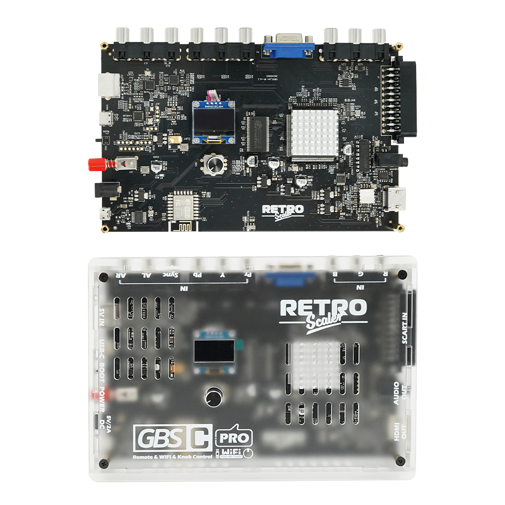
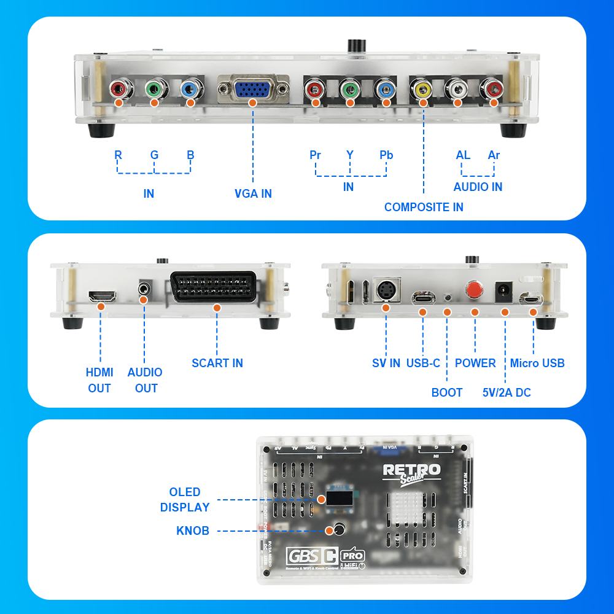

# Documentação

Firmware do **GBSC Pro** (ESP8266) em português do Brasil, baseado no firmware do brisma (`brisma/gbsc-pro`, versão 2.4.1), que deriva do `gbs-control` de ramapcsx2.

<p align="center">
    
</p>

## Sumário

1. [Instalação](#1-instalação)
2. [Conexões](#2-conexões)
3. [Idioma](#3-idioma)
4. [Imagem e escala](#4-imagem-e-escala)
5. [Scanlines](#5-scanlines)
6. [Configuração da TV](#6-configuração-da-tv)
7. [Padrões de fábrica](#7-padrões-de-fábrica)
8. [Acesso pela rede](#8-acesso-pela-rede)
9. [Compilação](#9-compilação)
10. [Traduções](#10-traduções)
11. [Alterações no código](#11-alterações-no-código)

---

## 1. Instalação

Arquivos da pasta `releases/`:

| Arquivo | Descrição |
|---|---|
| `firmware-gbsc-pro-by-jovemlcxx.bin` | Firmware do ESP8266 |
| `GBSC_PRO_AVMODULE_v2.4.1.bin` | Firmware do módulo AV (HC32), versão 2.4.1 |
| `NodeMCU-PyFlasher.exe` | Gravador do ESP8266 |
| `GBSC_PRO_Programmer.exe` | Gravador do módulo AV |

### ESP8266 (firmware principal)
1. Abra o `NodeMCU-PyFlasher.exe`.
2. Selecione a porta COM da GBS, o arquivo `firmware-gbsc-pro-by-jovemlcxx.bin`, velocidade **115200** e modo **Dual I/O (DIO)**.
3. Em **Erase flash**:
   - **no**: mantém WiFi, presets e configurações (recomendado para atualizar);
   - **yes**: restaura tudo para os padrões do firmware.
4. Clique em **Flash NodeMCU**. Ao terminar, desligue e ligue a GBS.

### Módulo AV (HC32)
Use o `GBSC_PRO_Programmer.exe` com o arquivo `GBSC_PRO_AVMODULE_v2.4.1.bin`. Basta gravar uma vez: este firmware não altera o protocolo com o módulo AV.

---

## 2. Conexões

<p align="center">
    
</p>

| Entrada ou saída | Uso |
|---|---|
| R, G, B | Entrada RGB (RGBS, RGsB) |
| VGA IN | Entrada VGA / RGBHV |
| Pr, Y, Pb | Entrada componente (YPbPr) |
| COMPOSITE IN | Entrada de vídeo composto |
| AL, Ar | Entrada de áudio |
| SCART IN | Entrada SCART (RGB) |
| SV IN | Entrada S-Video |
| HDMI OUT | Saída de vídeo |
| AUDIO OUT | Saída de áudio |
| USB-C, Micro USB | Gravação do firmware |
| BOOT | Modo de gravação |
| POWER e 5V/2A DC | Liga/desliga e alimentação |

O display **OLED** e o **knob** na parte superior dão acesso ao menu sem o controle remoto.

---

## 3. Idioma

- O firmware tem **PT-BR e EN-US** no menu OLED, no menu da TV e na Web.
- Para trocar:
  - **Controle remoto:** Menu → página 4 → **Idioma** (esquerda, direita ou OK);
  - **Menu OLED por bitmaps:** item **Idioma**, antes de *Versão do firmware*;
  - **Web:** Settings → **Idioma**.
- O idioma escolhido fica salvo.
- No OLED e na TV os textos não têm acentos, porque as fontes desses dois só têm ASCII. Na Web os acentos aparecem normalmente.
- Nos itens de menu, todas as palavras começam com maiúscula, exceto *de, do, da, dos, das* (em inglês: *of, to, the, and, or, in, on*). Frases e mensagens seguem a caixa normal.
- Na TV, o layout em português é igual ao do inglês: o tracejado começa logo após o rótulo e os valores ficam alinhados à direita.

---

## 4. Imagem e escala

### Quadro 4:3
Com **Quadro 4:3** ligado (padrão), a janela visível é um quadro 4:3 exato, centralizado em todas as resoluções. O que passar dele é cortado. Em 1280x1024 o quadro ocupa a largura inteira da tela.

A cada troca de preset, o firmware calcula a escala horizontal para que a imagem preencha o quadro.

Para ligar ou desligar: Web → Settings → *Quadro 4:3*, ou Developer → página 6.

### Mover e esticar
Todos os passos são de cerca de **1 pixel** por toque.

| Controle | Efeito |
|---|---|
| **Mover** | Desloca a imagem dentro do quadro (horizontal e vertical) |
| **Escala, horizontal** | Direita: mais largo. Esquerda: mais estreito. Cresce para a direita, com a borda esquerda fixa |
| **Escala, vertical** | Cima: mais alto. Baixo: mais baixo. Cresce para baixo, com a borda superior fixa |

As direções do controle remoto são as mesmas da Web.

### Centralizar e Redefinir escala
Ficam no menu *Ajustes de Tela* (página 2), na Web (Picture Control) e, no controle, a tecla **INFO** nas telas Mover e Escala executa o Centralizar.

| Opção | Mantém o tamanho | Zera o movimento |
|---|---|---|
| **Centralizar** | Sim | Sim |
| **Redefinir escala** | Não, volta ao ajuste automático | Sim |

Os ajustes manuais são guardados por norma (NTSC e PAL) e reaplicados, centralizados, ao religar.

### Ajustes de tela
Mover, Escala, Bordas e Altura Total continuam no menu e na Web (painel *Picture Control* e opção *Full Height*).

---

## 5. Scanlines

As scanlines vêm **ligadas e configuradas**, com intensidade 00 (a mais escura).

- O TV5725 escurece as linhas da imagem no deinterlacer, **antes** de escalar. Não há overlay.
- Intensidade de 00 a 50, ajustável pelo menu da TV, menu OLED, controle remoto e Web.
- Funcionam com fontes 240p/288p, ou 480i/576i com deinterlace *Bob*, inclusive no modo RGB/HV (SCART).
- Trocar de preset, mudar a resolução ou reiniciar mantém a configuração.

| Saída | Fator vertical (240p) | Scanlines |
|---|---|---|
| 1280x960 | 4× | Perfeitas |
| 1280x720 | 3× | Regulares |
| 1920x1080 | 4,5× | Regulares |

Esticar a imagem na vertical fora dos fatores inteiros torna o padrão irregular. Use *Centralizar* ou *Redefinir escala* para voltar ao padrão.

### Limitações conhecidas
- **1080p PAL (50 Hz):** o quadro 4:3 não fecha, porque a escala horizontal do chip já está no limite.
- **480p/576p:** o quadro já é 4:3, então não há ajuste.
- **Overlay:** o chip não tem camada gráfica para sobrepor imagens ou máscaras. O OSD da TV (STV9426) tem 28×3 caracteres.

---

## 6. Configuração da TV

| Saída | Ajuste na TV |
|---|---|
| 1920x1080, 1280x720, 480p | Nenhum |
| **1280x960, 1280x1024** | **Nível de preto: Baixo / Faixa HDMI: Limitada** na entrada da GBS |

A saída HDMI é feita pelo conversor **MS9288A** da placa, que entrega o preto em 16 (faixa limitada). A TV expande isso sozinha nos formatos de vídeo (1080p e 720p), mas não nos formatos de PC (960p e 1024p). Sem o ajuste, o 960p fica com cores lavadas e borda cinza. O firmware não controla o MS9288A, por isso o ajuste é feito na TV.

---

## 7. Padrões de fábrica

| Item | Padrão |
|---|---|
| Idioma | PT-BR |
| Resolução de saída | 1920x1080 |
| Quadro 4:3 | Ligado |
| Scanlines | Ligadas, intensidade 00 |
| Filtro de Linha | Ligado |
| Nitidez | Ligada |
| Pixels duros (filtro de 6 taps desviado) | Ligado |
| Active FrameTime Lock | Ligado |
| HDMI Limited Range | Desligado |
| Tema do menu da TV | Escuro |
| Volume | 35 |

Na primeira inicialização depois de gravar, o firmware aplica esses padrões **uma única vez** às preferências e aos slots já salvos. Depois disso, tudo continua configurável.

Ao ligar, o firmware reaplica o preset uma vez, automaticamente, depois que o sinal estabiliza. Isso evita a borda cinza causada pelo conversor HDMI.

Os filtros em uso (scanlines, intensidade, filtro de linha, peaking, resposta de cor) são mantidos ao trocar de preset ou reiniciar. Os filtros do slot só são restaurados se *Save Filtering Per Slot* estiver ligado na Web.

---

## 8. Acesso pela rede

A GBS responde em `http://gbscontrol.local/` ou pelo IP dela.

| Endpoint | Uso |
|---|---|
| `GET /lang` · `/lang?set=0\|1` | Consulta ou troca o idioma (0 = EN-US, 1 = PT-BR) |
| `GET /fit` · `/fit?set=0\|1` | Quadro 4:3 desligado ou ligado (reaplica o preset; `set=1` também descarta a escala manual) |
| `GET /range` · `/range?set=0..15` | Expansão de faixa de cor por classe de saída (bit0 480p, bit1 720p, bit2 960p/1024p, bit3 1080p). Padrão 0 |
| `GET /reg?s=3&r=35` | Lê o registrador `s3_35` (hexadecimal) |
| `GET /reg?s=3&r=35&v=95` | Escreve `0x95` em `s3_35` |
| `GET /reg` | Resultado da última operação (`seq` aumenta a cada leitura ou escrita) |

As escritas via `/reg` são temporárias e valem até o próximo carregamento de preset. Os logs aparecem no console da aba Developer da Web (WebSocket, porta 81).

---

## 9. Compilação

Requisitos: Python 3, PlatformIO (`pip install platformio`) e Node.js.

```bash
# Firmware (a partir de firmware/)
python -m platformio run
# saída: .pio/build/gbsc-pro/firmware.bin
```

```bash
# Web UI (a partir de firmware/public/), depois recompile o firmware
npm install
npx tsc ./src/index.ts --target ES6
cd scripts && node ./build.js && bash ./html2h.sh
```

```bash
# Textos em bitmap do menu OLED em PT-BR (a partir de firmware/)
python generate_translations.py pt-BR --suffix _PT -f "C:/Windows/Fonts/arial.ttf" -o OLEDMenuTranslations_pt.h
```

---

## 10. Traduções

- **OLED e TV:** tabela `I18N_TABLE` em `firmware/pro/i18n.cpp`, no formato `X("Texto em inglês", "Texto em português")`. O texto em inglês do código é a chave; o que não estiver na tabela aparece em inglês.
  - Somente ASCII (sem acentos).
  - O OLED tem **128 px** de largura (fonte ArialMT 16) e a TV tem **28 colunas**: o texto deve terminar antes do valor da linha.
  - Textos menores que o original são completados com espaços, e o tracejado se ajusta ao tamanho do texto.
- **Web:** dicionário `I18N_PT` em `firmware/public/src/index.ts` (com acentos).
- **Bitmaps do OLED:** chave `"pt-BR"` em `firmware/generate_translations.py`.

---

## 11. Alterações no código

Arquivos novos:
- `pro/i18n.h`, `pro/i18n.cpp`: traduções, idioma e troca de bitmaps.
- `OLEDMenuTranslations_pt.h`: bitmaps PT-BR (gerado).

Arquivos alterados:
- `gbs-control.ino`: padrões e migrações, reaplicação no boot, quadro 4:3, mover e esticar, pixels duros, nitidez, endpoints e preservação dos filtros ao carregar slots.
- `pro/gbs-control-pro.cpp`: conversão de cor.
- `pro/drivers/stv9426.h`, `pro/osd/**`: textos traduzidos no OSD, ajuste do tracejado e menus Developer e Ajustes de Tela.
- `pro/menu/**`: menu Idioma, ordem das resoluções, Centralizar, Redefinir escala e scanlines sempre configuráveis.
- `OLEDMenuManager.*`, `OLEDMenuImplementation.cpp`: bitmaps traduzidos e item Idioma.
- `generate_translations.py`: textos PT-BR e opção `--suffix`.
- `public/src/*`, `webui.html`, `webui_html.h`: idioma da Web e opções *Idioma*, *Quadro 4:3*, *Centralizar* e *Redefinir escala*.
